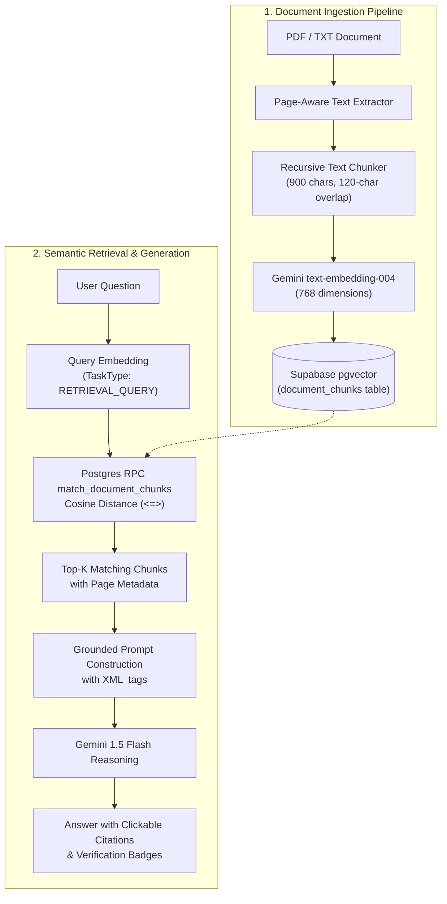

# 📚 RAG Knowledge Base — Full-Stack AI Application

A modern, production-ready **Retrieval-Augmented Generation (RAG)** application built with **Next.js 14 (App Router)**, **Google Gemini API**, and **Supabase (`pgvector`)**.

Upload your documents (PDF or TXT), ask questions in natural language, and receive accurate answers strictly grounded in the content — complete with verifiable page-level source citations and an interactive chunk inspector.

---

## ⚡ Key Highlights & Architecture

- **Conversational Memory & Chat History:** Persists chat sessions and message threads in Supabase. Supports follow-up questions (e.g. *"Can you elaborate on that policy?"* or *"How many days does it allow?"*) with automatic coreference resolution across conversation turns.
- **True Page-Aware Citations:** Parses PDFs by page boundary, allowing the LLM to cite the exact source document and page number (e.g. `[Doc: quarterly_report.pdf, Page 4]`).
- **Citation Inspector:** Click any citation badge in the chat UI to inspect the exact vector chunk, cosine match percentage, and raw text retrieved from PostgreSQL.
- **Strict Grounding Guardrails:** System prompts prevent hallucinations. If the context does not contain the answer, the model explicitly outputs *"I cannot find this information in the uploaded documents."*
- **Vector Space Indexing:** Employs Google Gemini's `text-embedding-004` (768-dimensional embeddings) and Supabase `pgvector` with HNSW index for sub-second vector cosine distance search (`<=>`).
- **Unified Backend:** Document storage, vector search, and relational metadata all live inside Supabase.

---

## 🏗️ System Workflow



---

## 🛠️ Technology Stack

| Layer | Technology | Details |
| :--- | :--- | :--- |
| **Frontend** | React, Next.js 14 (App Router), TypeScript, Tailwind CSS | Responsive split-dashboard with Lucide icons & markdown rendering |
| **LLM & Reasoning** | Google Gemini 1.5 Flash | Blazing fast inference, generous free tier (15 RPM), high context window |
| **Embedding Model** | Google `text-embedding-004` | 768-dimensional dense vector embeddings |
| **Vector DB & Storage** | Supabase (PostgreSQL + `pgvector` + Storage) | Unified storage bucket + HNSW indexed vector similarity search |
| **Document Processing** | `pdf-parse` (Page-level extraction) | Preserves exact page numbers for verifiable citations |

---

## 🚀 Quickstart & Setup Guide

### 1. Clone & Install Dependencies
```bash
git clone https://github.com/your-username/rag-knowledge-base.git
cd rag-knowledge-base
npm install
```

### 2. Configure Environment Variables
Create a `.env.local` file in the root directory:
```env
# Google Gemini API Key (Get free key from https://aistudio.google.com/)
GEMINI_API_KEY="your-gemini-api-key"

# Supabase Credentials (Get from Supabase > Project Settings > API)
NEXT_PUBLIC_SUPABASE_URL="https://your-project.supabase.co"
NEXT_PUBLIC_SUPABASE_ANON_KEY="your-anon-public-key"
SUPABASE_SERVICE_ROLE_KEY="your-service-role-key"
```

### 3. Initialize Supabase Database
1. In your **Supabase Dashboard**, open the **SQL Editor**.
2. Run the migration script located at [`supabase/migrations/20261126_init_rag.sql`](./supabase/migrations/20261126_init_rag.sql):
   - Enables the `vector` extension.
   - Creates the `documents` and `document_chunks` tables.
   - Adds the HNSW cosine similarity index.
   - Creates the stored procedure `match_document_chunks`.
3. In **Storage**, create a new bucket named `documents`.

### 4. Run the Development Server
```bash
npm run dev
```
Open [http://localhost:3000](http://localhost:3000) in your browser.

---

## 🧠 Core RAG Concepts (Interview & Portfolio Deep Dive)

### 1. Chunk Size & Overlap Trade-offs
- **Too small:** Chunks lose context, meaning vector embeddings fail to capture the broader semantic intent.
- **Too large:** Vectors become generic averages of multiple topics, diluting similarity ranking.
- **Why Overlap Matters:** Splitting strictly by character count cuts sentences mid-thought. A 10–15% overlap (120 characters in our implementation) ensures that transitional phrases and compound ideas are preserved across chunk boundaries.

### 2. Cosine Distance vs. Euclidean Distance
- Euclidean distance measures absolute straight-line distance, which is sensitive to chunk length.
- **Cosine distance** measures the cosine of the angle between two high-dimensional vectors:
  $$\text{Cosine Similarity} = \frac{A \cdot B}{\|A\| \|B\|}$$
- In `pgvector`, the `<=>` operator computes cosine distance ($1 - \text{similarity}$). It evaluates semantic orientation regardless of word count.

### 3. Grounded Prompt Engineering & Negative Constraints
To guarantee zero-hallucinations, the system prompt isolates the retrieved excerpts inside `<context>` tags and applies explicit negative-constraint instructions:
```text
If the provided excerpts do not contain sufficient evidence to answer the question,
state: "I cannot find this information in the uploaded documents."
Do NOT extrapolate or invent details.
```

### 4. Why `pgvector` over Standalone Vector DBs
Rather than synchronizing state across two separate databases (e.g. relational DB for user data + Pinecone for vectors), `pgvector` allows atomic relational operations, document cascades, metadata filters, and vector searches within a single transactional PostgreSQL instance.

---

## 📡 API Reference

- `POST /api/documents/upload` — Multipart form upload (`PDF` or `TXT`, max 10MB). Automatically parses pages, chunks text, generates embeddings, and saves to database.
- `GET /api/documents` — Lists all indexed documents with status and chunk count.
- `DELETE /api/documents/:id` — Deletes document from storage and cascades deletion of vector chunks.
- `POST /api/chat` — Body: `{ message, documentId? }`. Embeds query, performs vector search, and returns grounded answer with structured citations.
- `POST /api/search` — Body: `{ query, documentId? }`. Direct semantic retrieval endpoint returning raw matching chunks with cosine similarity scores.
- `GET /api/health` — Returns status of environment variables and database connectivity.

---

## 📄 License
MIT License. Built for learning, experimentation, and portfolio demonstration.
